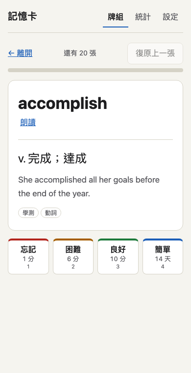

# 記憶卡
Spaced-repetition flashcards for vocabulary, with FSRS-4.5 and SM-2 scheduling, that works offline as a PWA.

間隔重複背單字的網頁 App。可以離線使用、加到手機主畫面，資料只存在你自己的瀏覽器裡。

**Demo：** https://useless-husband.github.io/memo-cards/



## 這是什麼

記憶卡是一個純靜態的網頁 App：沒有後端、沒有帳號、不需要建置，也沒有任何第三方套件。
它用間隔重複（spaced repetition）幫你安排複習時間：記得越熟的卡片，隔越久才再出現；忘記的卡片會很快再看到。

內建一個原創的示範牌組「英文學測／多益常見單字 100」，單字、詞性、中文意思與例句都是自己寫的。

## 功能

- 牌組管理：多個牌組；新增、編輯、刪除卡片（正面、背面、例句、標籤）；搜尋。
- 匯入匯出：貼上或選擇 CSV／TSV 檔匯入，可自訂欄位對應、預覽、偵測重複；匯出 CSV；匯出 JSON 完整備份，也能從 JSON 還原。
- 排程演算法：FSRS-4.5（預設，可調目標保留率）與經典 SM-2，可隨時切換，既有卡片會自動換算。
- 四個評分按鈕「忘記／困難／良好／簡單」，按鈕上直接顯示下次間隔，例如「10 分」「3 天」。
- 複習流程：每日新卡與複習上限、學習步驟（預設 1 分、10 分）、復原上一張、進度條、完成畫面、可自訂換日時間（預設凌晨 4 點）。
- 動畫克制：翻面只有很短的淡入，可以在設定關閉，系統開啟「減少動態效果」時自動停用。
- 統計：今日複習數、連續天數、30 天保留率、未來 30 天到期預測長條圖、卡片狀態分布（新卡／學習中／複習／已遺忘）。圖表是自己畫的 SVG。
- 朗讀：用瀏覽器內建語音念英文單字，可關閉，也可設定出現新卡時自動念。
- PWA：Service Worker 預先快取全部檔案，離線可用；有新版本時會提示，不會卡在舊版。資料放在 IndexedDB。
- 淺色與深色主題（跟隨系統）、手機寬度優先、可用鍵盤操作。

## 安裝與執行

### 方法一：直接用線上版

打開 https://useless-husband.github.io/memo-cards/ 就能用。

### 加到 iPhone 主畫面

1. 用 Safari 打開上面的網址（一定要用 Safari）。
2. 點下方工具列中間的「分享」按鈕（方框加向上箭頭）。
3. 往下滑，點「加入主畫面」。
4. 名稱維持「記憶卡」，點右上角「新增」。
5. 回到主畫面，點「記憶卡」圖示開啟。第一次開啟時請保持連網，載入完成後之後離線也能用。

Android 的 Chrome 可以點右上角選單，選「安裝應用程式」或「加到主畫面」。

注意：資料存在這支手機的瀏覽器裡。換手機、或在 Safari 清除網站資料之前，請先到「設定」按「匯出 JSON 備份」。

### 方法二：在自己的電腦上執行

需要 Node.js 22 以上（只是用來開一個本機網頁伺服器，App 本身不需要 Node）。

```bash
git clone https://github.com/useless-husband/memo-cards.git
cd memo-cards
node scripts/serve.js
```

然後用瀏覽器打開 http://localhost:8080/ 。想換埠號可以寫 `node scripts/serve.js 3000`。
也可以用任何靜態伺服器，例如 `python3 -m http.server 8080`。

Service Worker 只能在 `https://` 或 `http://localhost` 下運作，直接雙擊 `index.html`（`file://`）可以看到畫面，但沒有離線功能。

### 方法三：發佈到 GitHub Pages

1. 把專案推到 GitHub。
2. Settings → Pages → Source 選 `Deploy from a branch`，Branch 選 `main`、資料夾選 `/ (root)`。
3. 幾分鐘後就會出現 `https://<你的帳號>.github.io/memo-cards/`。

## 使用說明

1. 首頁會列出牌組，數字分別是今天可做的新卡、學習中、待複習張數。按「開始複習」。
2. 看到正面先想答案，按「顯示答案」（或空白鍵）。
3. 依照記得的程度評分：

   | 按鈕 | 鍵盤 | 意思 |
   | --- | --- | --- |
   | 忘記 | 1 | 完全想不起來，很快再出現 |
   | 困難 | 2 | 想了很久才想到 |
   | 良好 | 3 | 順利想起來 |
   | 簡單 | 4 | 幾乎立刻想起來，隔更久再見 |

4. 按錯了就按「復原上一張」（或 `u`、`Ctrl+Z`）。
5. 「牌組 → 管理卡片」可以新增、編輯、刪除卡片，也能匯入 CSV。
6. 匯入格式：一列一張卡，欄位為 正面、背面、例句、標籤。有標題列時會自動猜欄位（支援「正面／背面／單字／意思／例句／標籤」及對應英文），猜錯可以手動改。標籤以空白、分號或頓號分隔。檔案請用 UTF-8。
   ```csv
   正面,背面,例句,標籤
   budget,n. 預算,Our monthly budget is small.,多益 財務
   ```
7. 「設定」可以調整演算法、目標保留率、每日上限、學習步驟、換日時間、動畫與朗讀。

## 專案結構

```
memo-cards/
├── index.html              入口頁
├── styles.css              樣式（淺色／深色）
├── manifest.webmanifest    PWA 資訊
├── sw.js                   Service Worker（版本與快取清單由 scripts/stamp-sw.js 產生）
├── icons/                  App 圖示（SVG 與 PNG）
├── src/
│   ├── fsrs.js             FSRS-4.5 公式
│   ├── sm2.js              SM-2
│   ├── scheduler.js        單張卡片的排程（學習步驟＋兩種演算法）、按鈕間隔預覽
│   ├── queue.js            每日上限與出題順序
│   ├── session.js          一次複習流程：作答、復原、進度
│   ├── dates.js            換日、時區、間隔文字
│   ├── csv.js              CSV／TSV 解析與輸出
│   ├── importer.js         欄位對應、驗證、重複偵測
│   ├── backup.js           JSON 備份的產生與驗證
│   ├── stats.js            統計計算
│   ├── charts.js           SVG 圖表
│   ├── store.js            IndexedDB 與記憶體儲存
│   ├── settings.js         設定與正規化
│   ├── tts.js              朗讀
│   ├── demo-deck.js        示範牌組 100 字
│   ├── dom.js              小型 DOM 工具
│   ├── app.js              進入點、路由、Service Worker 註冊
│   └── views/              各個畫面
├── scripts/
│   ├── serve.js            本機靜態伺服器
│   ├── assets.js           快取清單與版本雜湊
│   └── stamp-sw.js         把版本寫進 sw.js
├── test/                   單元測試（node --test）
├── e2e/pwa.e2e.js          Playwright 端對端測試（離線、更新）
└── .github/workflows/ci.yml
```

## 如何跑測試

單元測試沒有任何依賴，只要 Node.js 22 以上：

```bash
npm test
# 等同於
node --test "test/*.test.js"
```

測試涵蓋 FSRS 與 SM-2 的計算、排程（用假時鐘測跨日、時區、每日上限、換日時刻）、CSV 解析、匯入驗證、備份驗證、統計、圖表與 Service Worker 快取清單。所有時間與亂數都由外部注入，不依賴真實時間或網路。

端對端測試會開真的瀏覽器，驗證 Service Worker 註冊、離線重新整理仍可開啟、新版本更新流程。Playwright 只在這個測試需要，不是專案依賴：

```bash
npm install --no-save playwright
npx playwright install chromium
node e2e/pwa.e2e.js
```

**修改任何要快取的檔案後**（`index.html`、`styles.css`、`src/`、`icons/`），要先執行：

```bash
npm run stamp
```

它會把檔案內容雜湊寫進 `sw.js` 的 `VERSION`，使用者的瀏覽器才會知道有新版本。忘記執行的話，單元測試會失敗提醒你。

## 原理簡介

### FSRS-4.5

FSRS（Free Spaced Repetition Scheduler）為每張卡片維護兩個數字：

- 穩定度 S：記憶能維持多久。定義為「可提取性從 100% 掉到 90% 所需的天數」。
- 難度 D：1 到 10，越高越難。

經過 t 天後想起來的機率是 `R = (1 + 19/81 · t/S)^(-0.5)`。App 會挑一個間隔，讓下次複習時的 R 剛好等於你設定的目標保留率（預設 90%，此時間隔約等於 S）。每次評分後，依公式更新 S 與 D：答對時 S 會變大（越接近忘記邊緣才複習，成長越多），忘記時 S 大幅下降。預設參數是 FSRS-4.5 的 17 個預設值。

本專案是依公開公式自行實作，沒有複製任何程式碼。來源：

- Ye, J., Su, J., Cao, Y. "A Stochastic Shortest Path Algorithm for Optimizing Spaced Repetition Scheduling." KDD 2022.
- open-spaced-repetition 的 FSRS 說明文件：https://github.com/open-spaced-repetition/fsrs4anki/wiki/The-Algorithm

與官方實作的差異（為了簡單）：學習步驟期間只更新難度、不更新穩定度；沒有隨機擾動（fuzz），所以相同操作永遠得到相同排程；預設參數沒有針對個人資料最佳化。

### SM-2

經典 SM-2（Piotr Wozniak, 1987）：第一次答對 1 天、第二次 6 天，之後間隔乘上易度係數 EF，EF 依評分調整、最低 1.3。四按鈕對應品質 1、3、4、5；忘記時 EF 減 0.2（沿用 Anki 的做法）。

### 學習步驟與每日流程

新卡與忘記的卡片先經過短間隔的學習步驟（預設 1 分、10 分；忘記後重學 10 分），畢業後才用演算法排「天」的間隔。出題順序是：已到期的學習中卡片、待複習卡片、新卡。複習卡的到期時間記在「換日時刻」（預設凌晨 4 點），所以「3 天後」就是第三天的凌晨 4 點起可以複習，不是剛好 72 小時。

### 測試向量

FSRS 的期望值來自一份獨立、逐行對照公開公式寫成的 Python 計算（初始穩定度、初始難度、以及「良好→良好→良好→困難→簡單→忘記」的連續更新），另有數學性質檢查（例如 t = S 時 R = 90%、保留率 90% 時間隔等於 S）。

### 更新策略

`sw.js` 的版本字串是所有快取檔案的內容雜湊。使用者第一次安裝時直接啟用；之後若有新版，新的 Service Worker 會在背景安裝並等待，頁面顯示「有新版本可以使用」，按下「立即更新」後才切換並重新載入。這樣不會在使用到一半時，讓新舊檔案混在一起。舊版快取在新版啟用時清除。

## 已知限制

- 資料只存在單一裝置的瀏覽器，沒有雲端同步；請定期匯出備份。
- 朗讀依賴瀏覽器內建語音，品質與可用語言因裝置而異。
- 私密瀏覽模式或封鎖網站資料時，IndexedDB 可能無法使用，此時 App 會顯示警告，資料只在該分頁存在。
- 沒有針對個人資料最佳化 FSRS 參數。

## 授權

MIT，見 [LICENSE](LICENSE)。
